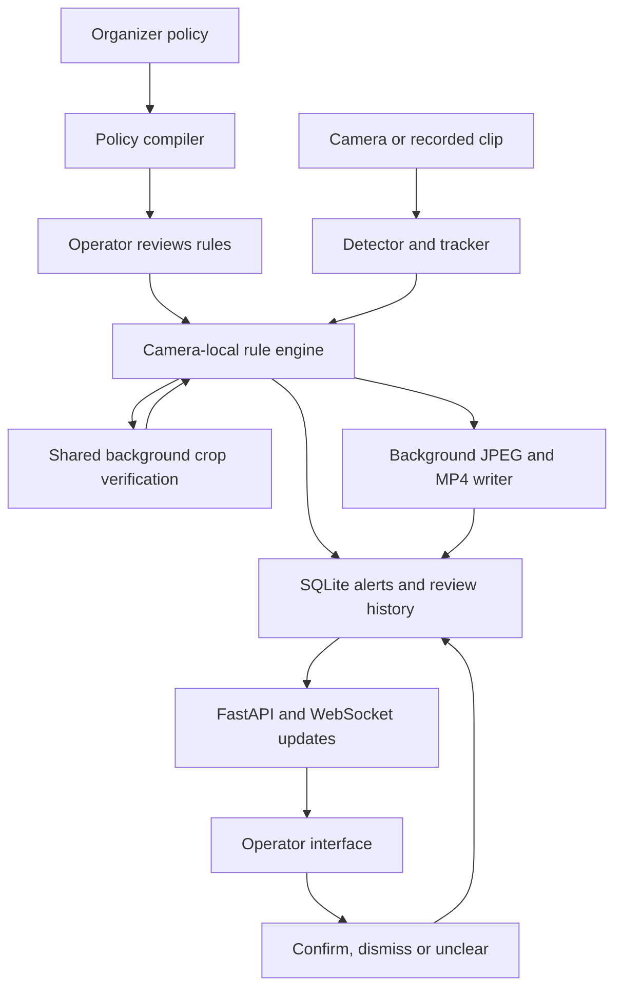

# PolicyLens

Program cameras with a venue policy written in plain English. Local detection,
tracking, zones and duration checks produce evidence-backed alerts for human
review. Gemini compiles policies and verifies selected uncertain crops.

Inspired by HawkWatch's camera-to-incident product loop; PolicyLens focuses on
user-defined policies, deterministic temporal rules and operator decisions.

## Implemented checkpoint: Person 4 backend and evaluation

- Approved shared Pydantic models: `backend/app/models.py`.
- HTTP, WebSocket and integration agreements: `contracts/api.md`.
- Generated JSON schemas and validated demo payloads: `contracts/models.schema.json`
  and `contracts/examples.json`.
- Normalized zone geometry, with polygon configuration validation.
- A camera-local persistent-object engine: duration thresholds, one alert per
  incident, 1 s detection grace, 2 s closure, conservative tracking-ID recovery,
  source-relative timestamps and detection confidence averaged over observations.
- Deterministic synthetic tracking scenarios and a replay command.
- Attribute rules with best-crop selection, session/track caching, background
  verification, a shared two-calls-per-second start limit, and four-second timeouts.
- Explicit canned-result verifier for offline work and an injectable Person 2
  verifier callable. Compliant results stay quiet; violations and unclear results
  create one review alert per incident.
- Bounded source-frame buffering, annotated JPEGs, approximately the last four
  seconds of MP4 evidence, and asynchronous completion patches.
- A recorded-video + saved-track replay command and labeled synthetic demo inputs.
- FastAPI routes, annotated MJPEG streams, WebSocket updates and evidence serving.
- Transactional SQLite alerts/review history and atomic JSON configuration.
- Independent camera workers with bounded capture queues, reconnect attempts and
  idempotent start/stop. An unavailable camera does not stop another camera.
- An explicit adapter for Person 1's draft track objects and Person 2's compiler.
- A 20-case evaluation manifest and runner with positive/negative event scoring.

Parts A and B are implemented and tested with offline sources. Part C's runner
and functional fixtures are implemented. Real-camera/model accuracy and the
complete frontend still require teammate integration and real footage. A real
Gemini provider is not included in this branch; integrated mode loads Person 2's
callable when available. The default verifier is an explicitly unclear stub,
never a claim of real visual classification.

All development is on `person4-integration`, with incremental implementation
commits. Push only when requested. Do not commit `.env`, virtual environments, generated
evaluation tracks, Python caches, or operating-system metadata.

## Setup

Use Python 3.11 or newer. From the repository root:

```sh
python3.11 -m venv backend/.venv
source backend/.venv/bin/activate
python -m pip install -r backend/app/requirements.txt
cd backend
```

Dependencies are Pydantic v2, NumPy, OpenCV, FastAPI and uvicorn. For tests,
also install `python -m pip install -r app/requirements-dev.txt` from `backend/`.
No camera, Gemini key, model download or network is needed for offline checks
after dependency installation.

## Run the backend

From `backend/`, initialize a **fresh** offline demo and start the server:

```sh
python -B -m app.seed_demo
uvicorn app.main:app --host 127.0.0.1 --port 8000
```

The setup command creates two labeled synthetic clips, matching tracks, zones
and the three demo rules. It refuses to overwrite existing settings. Runtime
data lives in ignored `backend/store/runtime/` by default; set
`POLICYLENS_DATA_DIR` before both commands to use another directory.

Open `http://127.0.0.1:8000/docs` for the interactive API. Start with
`POST /api/monitor/start`. Both cameras play once in real time; the entrance
produces manual-review alerts because its verifier is a stub, and the exit bag
produces one urgent alert after five seconds. Clips reaching EOF become offline;
press stop before editing configuration or replaying them. Starting again after
stopping creates a new session, preserving previous alerts and decisions.

Person 3's Vite application can proxy `/api`, `/ws` and `/evidence` to this server
without changing the approved routes. The frontend itself is not part of this
branch. `GET /api/snapshot/{camera_id}` also works before monitoring so its setup
screen can draw zones on a preview.

Default `POLICYLENS_MODE=demo` uses saved tracks and a fixed demo-policy mapping;
compile responses carry an explicit DEMO warning and never activate rules.
Review/edit rules and save them with `PUT /api/policy` before monitoring. To use
real modules after integration, set `POLICYLENS_MODE=integrated` and install
teammates' dependencies. That mode requires `vision.pipeline`, `policy.compiler`
and `verify.verifier`; unavailable integrations are not silently replaced with
the offline demo.

Configuration edits while monitoring return 409. Unknown references, malformed
polygons and invalid fields return 422. Start/stop are safe to repeat. If a source
cannot stop promptly, stop returns a retryable 409 rather than starting duplicate
workers. Live sources retry every two seconds; recorded EOF does not auto-replay.

## Tests and replay

From `backend/`:

```sh
python -B -m unittest discover -v
python -B -m engine.fake_tracks ../eval/generated
python -B -m engine.replay ../eval/generated/exit_bag.tracks.jsonl
python -B -m engine.replay ../eval/generated/dropout.tracks.jsonl
python -B -m engine.replay ../eval/generated/reentry.tracks.jsonl
```

Replay prints one JSON alert per line to stdout and a summary to stderr. It uses
synthetic exit geometry unless `--config PATH` supplies a JSON object containing
`zones` and `rules` arrays. Track-only attribute replay cannot inspect images, so
eligible attribute candidates produce manual-review alerts without provider calls.
Replays use deterministic IDs and placeholder UTC times anchored to 1970-01-01;
the `ts` values remain actual positions in the source data. Live timestamps will
be recorded at incident creation.

`exit_bag` should alert once at 5.0 s. `dropout` should also alert once at 5.0 s
despite a 0.6 s missing-detection interval. `reentry` alerts at 5.0 s and 16.0 s
with different incident IDs. `threshold_dropout` waits for an observed frame at
5.4 s; it cannot alert from missing frames at the threshold.

Synthetic files sample at 10 Hz and test code behavior, not model accuracy.
See `eval/synthetic-results.md` for the earlier temporal checkpoint and
`eval/part-a-results.md` for the verification/evidence checkpoint. The current
backend and evaluation results are in `eval/backend-results.md`.

## Recorded-video offline demo

From `backend/`, generate labeled synthetic video and matching saved tracks:

```sh
python -B -m engine.demo_recording ../eval/generated/part_a
```

Replay the exit scenario, which produces one alert with an annotated JPEG and a
four-second MP4:

```sh
python -B -m engine.clip_replay \
  ../eval/generated/part_a/exit.mp4 \
  ../eval/generated/part_a/exit.tracks.jsonl \
  --config ../eval/generated/part_a/config.json \
  --evidence ../eval/generated/part_a/exit-evidence
```

Replay entrance violations using **canned, not visually inferred** answers:

```sh
python -B -m engine.clip_replay \
  ../eval/generated/part_a/entrance.mp4 \
  ../eval/generated/part_a/entrance.tracks.jsonl \
  --config ../eval/generated/part_a/config.json \
  --evidence ../eval/generated/part_a/entrance-evidence \
  --stub-bag opaque --stub-camera professional
```

This produces two alerts. Use `--stub-bag clear --stub-camera ordinary` for a
zero-alert compliant replay, or leave both as `unclear` for manual-review alerts.
Entrance rules trigger at 1 s, so only one second of pre-alert footage exists;
the writer saves that available history instead of inventing a four-second clip.

The generated pictures are labeled synthetic, the CLI prints its stub mode to
stderr, and canned verdict reasons are labeled STUB. Neither input nor result
is an accuracy benchmark. Alerts print to stdout after verification and evidence
jobs finish. The backend serves `/evidence/<generated-basename>` from its own
configured data directory. CLI output in a different directory is not
automatically hosted; use the backend's evidence directory if those URL paths
need to resolve through the running server.

To use real Person 2 verification once its module is present, select
`--verifier person2`. The command imports `verify.verifier.verify_crop` explicitly;
missing modules or configuration are not silently replaced with canned results.

## Integrating the background workers

Construct one shared `VerificationScheduler(verify_crop)` for all cameras and
pass it as `scheduler=` to each `RuleEngine`. Provider results are validated
against the approved Verdict model, including models from another Pydantic module.
Malformed results retry once within the same rate limit, then become unclear.
Queue saturation never blocks a frame: the engine retains the best crop and
retries submission on a later eligible observation. Cached checks are scoped by
camera, session, check type and original track ID; reset invalidates old results.

Construct one `EvidenceWriter(Path(...))` and pass it as `evidence_writer=`. Each
engine keeps its own bounded ring (up to 10 Hz, 640 px wide, 4.2 s and 32 MiB).
Verification captures its evidence window at submission, so a delayed response
cannot substitute later frames. JPEG and video encoding use separate background
workers. Initial alerts say `pending`; `engine.poll_evidence()` yields patches.
Use `patch.apply(latest_stored_alert)` before storing/broadcasting `alert_updated`;
this preserves operator decisions made while encoding was running. It does not
create a second incident. A ready patch can contain just a JPEG if video encoding
was unavailable; a failed snapshot produces `unavailable`.

Live frame loops use `update`, `poll_verifications` (also while a camera is idle)
and `poll_evidence`. At clip EOF or shutdown, collect `drain_verifications()`
before `drain_evidence()`. Only then close the shared workers. The drain helpers
block and must not run inside a live frame callback. The implemented camera
workers persist new alerts before broadcasting and merge evidence patches inside
SQLite transactions against the latest review decision. WebSocket clients receive
an initial snapshot and then `alert_updated` for evidence or human decisions.
Slow clients are disconnected with code 1013 so they can reload alerts via REST.

Verification and encoding latencies are logged through Python logging; enable
INFO-level logging in the host application. A timed-out provider cannot be killed
inside a Python thread. The caller receives an unclear result promptly, while
the still-running call retains its bounded worker slot. Person 2 must also set
a network timeout, as its verifier interface specifies.

To regenerate machine-readable contracts from the approved models:

```sh
python -B -m app.export_contracts ../contracts
```

## Evaluation

From the repository root:

```sh
python -B eval/generate_fixtures.py
python -B eval/run_eval.py --output eval/generated/evaluation-report.json
python -B -m unittest discover -s eval/tests -v
python -B eval/soak_backend.py --output eval/generated/soak-report.json
```

The checked-in `eval/cases.csv` has 20 **synthetic functional cases**, reusing
entrance clips with explicitly canned verdict combinations. On the recorded run,
20/20 passed: 17 expected alerts matched, 0 false alerts, 0 misses and 0 duplicates.
These are event-matching counts, not detector/classifier accuracy. Mean source
delay was 0.024 s and mean engine alert latency was 0.090 s for this offline run;
wall latency is measured from the first processed frame at the expected threshold
to alert emission. It excludes capture-to-UI delay and real Gemini/network costs.

The five-minute synthetic two-camera backend run passed without restart: 45
distinct alerts, 45 persisted review decisions and 45 ready evidence results.
This exercises the real API, WebSocket, workers and persistence through the test
client, not a physical camera or the complete frontend. The current automated
suite has 96 backend tests and five evaluator tests, all passing.

Use `python -B eval/run_eval.py path/to/real-cases.csv --mode integrated` for a
separate dataset with real footage and the same columns. This runs Person 1's
detector/tracker, the engine and Person 2's verifier at clip-processing speed;
the saved-track column is unused in that mode. Failures return a nonzero exit
code and appear as per-case errors, rather than becoming successful zero-alert
cases. Real integrated-mode accuracy has not been measured in this checkout.

## Architecture



Person 1's current branch uses its own tracking objects. `app/pipelines.py` maps
`class_name`/`conf` and frame metadata into the approved `object_class`/`confidence`
shape and normalizes live timestamps to a session clock. No teammate-owned files
were changed. Next integration work is validating this adapter with actual
cameras, exercising Person 2's real provider and reviewing the full frontend flow.
See `eval/demo-plan.md` for the demo script and integration checkpoints.

## Limitations and evaluation

No detection accuracy, real-camera throughput, real Gemini latency or live
end-to-end performance has been measured. Recorded synthetic inputs exercise
decoding and encoding; they are not footage of actual bags or cameras.
Synthetic success does not establish that a detector can see those objects.

Possible obstruction means a tracked object's bottom-center lies in a user-drawn
region; it does not establish physical passability. Timers bridge brief detection
gaps as a documented heuristic. Tracking-ID recovery is conservative and can miss
identity changes in crowded scenes. Attribute verdicts require human review.
